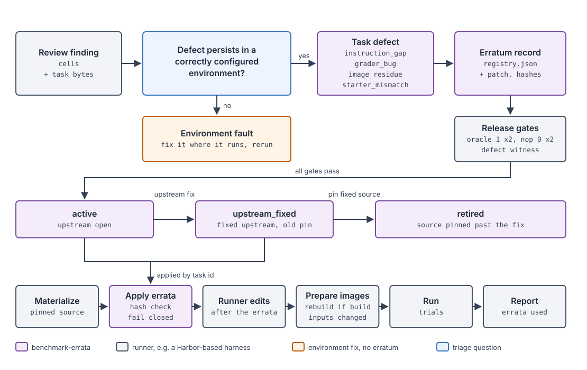

# benchmark-errata

Patches for defects in public agent-benchmark tasks: instructions that omit a requirement the grader checks, grader bugs, reference programs left in the agent's environment, and starter code that does not match the tests. Each erratum carries its evidence, its upstream report, the upstream revision it was written for and the SHA256 of every file it changes or depends on. A runner applies errata by task id after materializing a benchmark, and stops applying one once upstream fixes the task.

Only defects of the task or dataset itself are accepted. A fault of the evaluation environment (network policy, model gateway, host resources, image build tooling, the benchmark adapter, run budget) is fixed where it runs; the validator rejects those classes.



## Errata

| Erratum | Task | Defect | Upstream report | Status |
|---|---|---|---|---|
| `tb2-path-tracing-r1` | Terminal-Bench 2.0 `path-tracing` | The compiled reference renderer stays in the image | [harbor-framework/terminal-bench-2#61](https://github.com/harbor-framework/terminal-bench-2/issues/61) | active |
| `harbor-index-dacode-predict-essay-scores-r1` | Harbor Index `dacode-predict-essay-scores` | The QWK pass bar exists only in the grader | [harbor-framework/harbor-index#156](https://github.com/harbor-framework/harbor-index/pull/156) | active |
| `aider-polyglot-go-octal-r1` | Aider polyglot `go/octal` | The stub's signature does not match the tests | [Aider-AI/polyglot-benchmark#26](https://github.com/Aider-AI/polyglot-benchmark/pull/26) | active |

The records are in [`errata/registry.json`](errata/registry.json) and the patches under [`errata/patches/`](errata/patches/). Releases are published as the Hugging Face dataset [`mike-7777777/benchmark-errata`](https://huggingface.co/datasets/mike-7777777/benchmark-errata), one tag per version.

## What is published

Only patches, records and tools. No task files, data, expected answers or reference solutions are published, whatever the upstream license allows:

- a patch never changes a file under `solution/`;
- a patch that changes `tests/` states in `answer_review` that it adds no expected answer or ground truth;
- when the upstream terms forbid redistribution, the patch file stays out of this repository (`patch.storage: "external"`) and the record keeps only its SHA256 and how to construct it;
- every record carries the license conclusion it was published under (`license`).

## Use

```bash
uv sync
uv run benchmark-errata verify

# after materializing tasks as <root>/<benchmark>/<task_id>/
uv run benchmark-errata apply --tasks-root <root> \
  --source terminal-bench-2.0=<revision the tasks came from> \
  --benchmark-dir terminal-bench-2.0=<directory name your runner uses>
```

`apply` checks every pinned file before and after patching and refuses the whole root on any mismatch. It adds `benchmark_erratum = "<id>"` to the `[metadata]` table of each patched `task.toml` and writes `benchmark-errata.json` at the root with what it applied or skipped. `--include-candidates` also applies errata that have not passed their release gates yet; use it for gate runs only.

## Release gates

An erratum moves from `candidate` to `active` after the patched task scores 1 with the reference solution at least twice, 0 with a no-op agent at least twice, and a witness shows the defect on the upstream bytes and its absence after the patch. The design, the record fields and the lifecycle are in [docs/design.md](docs/design.md).

## License

Apache-2.0 for the tools, records and the text written here. Each patch modifies a task that has its own upstream license or terms; the record's `license` field names them.
