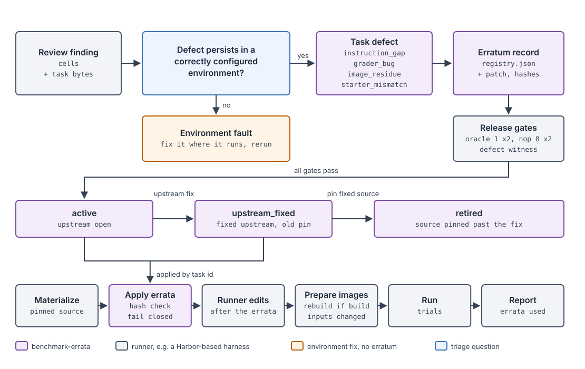

# Design

An erratum is our fix for a defect of an upstream benchmark task, kept as a record plus a patch until upstream fixes the task. A runner materializes the benchmark as usual and applies the live errata by task id before running it. When upstream fixes the task and the runner moves to the fixed revision, the erratum retires.

*Figure 1. A review finding is first split into environment faults, which are fixed where they run, and task defects of four classes. A task defect becomes a record with a patch, passes the release gates and is applied by task id; it retires once upstream fixes the task.*

## 1 Admission

### 1.1 Accepted defects

One question decides: does the defect persist in a correctly configured environment? If it does, it belongs to the task. Four classes qualify. The validator checks the two right-hand columns.

| Class | Meaning | The patch changes at least one of | The evidence cites at least one of |
|---|---|---|---|
| `instruction_gap` | The grader checks a requirement the instruction does not state | `instruction.md`, `tests/` | `tests/` |
| `grader_bug` | The grading logic is wrong (the reference fails, a parser misreads output) | `tests/` | `tests/` |
| `image_residue` | The built environment holds a reference program, an answer or hidden test data | `environment/` | `environment/` |
| `starter_mismatch` | The starter code's interface does not match what the tests call | `environment/`, `instruction.md` | `tests/` |

An erratum closes the gap between the instruction and the grader, or removes what does not belong in the environment. It never changes the question a task asks. A task that needs a different question to be answerable (for example, an answer that cannot be determined from the task's material) is not an erratum.

### 1.2 Rejected classes

`network_policy`, `gateway`, `bridge`, `gate`, `host`, `image_build`, `materializer` and `budget` are faults of the evaluation environment. The validator rejects them and points to fixing the environment and rerunning.

### 1.3 What the validator checks

`benchmark-errata verify` checks every record:

1. The class is one of the four in 1.1.
2. The patch changes only `instruction.md`, `README.md`, `task.toml`, `tests/` or `environment/`. In `task.toml` it may only drop `[environment].docker_image`, needed when an environment fix must be built; timeouts, resources and the agent table belong to the runner.
3. The changed paths satisfy the class's column in 1.1, and so do the paths the evidence cites.
4. Every cited file is pinned by a before-hash under `files` or `depends_on`.
5. Nothing under `solution/` is changed; a change under `tests/` comes with `answer_review`.
6. At most one erratum per task is not retired.
7. The status matches its fields (section 2.3), and `active` and `upstream_fixed` errata carry passing gates (section 3).
8. The patch's SHA256 matches the record, the patch changes exactly the files the record pins, and no patch file lacks a record.
9. The license conclusion is recorded, and a patch whose upstream forbids redistribution is not stored here (section 5).
10. The clean versions in `emcv.json` match the registry (section 7).

## 2 Records

### 2.1 Fields

| Field | Content |
|---|---|
| `id` | Lower-case, unique, e.g. `tb2-path-tracing-r1` |
| `benchmark`, `task_id` | The benchmark id and the Harbor task directory name |
| `source` | Upstream URL, revision (Git commit or `sha256:` digest of a frozen copy), and how the task directory was materialized |
| `status` | `candidate`, `active`, `upstream_fixed` or `retired` |
| `license` | Upstream licenses or terms, whether redistribution is allowed, the sources checked, the date and the conclusion |
| `defect` | Class, a one-sentence finding, and evidence as file, lines and fact |
| `answer_review` | For a change under `tests/`: why the patch adds no expected answer or ground truth |
| `upstream` | Upstream issue or pull request links, or why it is not reported; `fixed_in` once upstream fixes it |
| `patch` | Path and SHA256, or `storage: "external"` with only the SHA256 and the construction; where the patch came from |
| `files` | Before and after SHA256 of every file the patch changes |
| `depends_on` | SHA256 of files the fix relies on but does not change, usually the tests |
| `gates` | Release gate results (section 3) |
| `retired` | Date and reason |

### 2.2 Patches and hashes

A patch is a Git diff relative to the task directory as the benchmark's materializer writes it, before any runner-specific edit. Hashes are per file, not per tree:

- a materialized task can hold bytes that change on every run and have nothing to do with the defect (for example, an oracle encrypted with a random salt);
- `depends_on` pins the files the fix relies on. If upstream changes the tests but not the instruction, the erratum stops on the test's hash instead of applying an old instruction fix to new tests.

`apply` checks every before-hash and dependency, patches a copy, checks every after-hash, and replaces the task only when every erratum in the root has applied.

### 2.3 Lifecycle

| Status | Meaning | `apply` |
|---|---|---|
| `candidate` | Written, gates not yet passed | Skipped, unless `--include-candidates` (gate runs only) |
| `active` | Upstream not fixed | Applied when the task's source revision equals `source.revision`; refused otherwise |
| `upstream_fixed` | Upstream fixed; runners may still pin the old revision | Applied at `source.revision`; skipped at `upstream.fixed_in.revision`; refused otherwise |
| `retired` | Runners moved to the fixed revision | Never applied; the record and patch stay so old runs can be reproduced |

## 3 Release gates

An erratum moves from `candidate` to `active` after:

1. the reference solution scores 1 on the patched task at least twice;
2. a no-op agent scores 0 on the patched task at least twice;
3. a witness shows the defect on the upstream bytes and its absence after the patch:
   - `image_residue`: the residue is in the upstream image and not in the patched one;
   - `instruction_gap`, `starter_mismatch`: the requirement is in the tests and missing from the instruction or starter code, or the starter code does not build against the tests;
   - `grader_bug`: the upstream grader fails a known-correct solution and the patched one does not.

`gates.runtime` names how the gates were run. Gate runs make no model calls.

## 4 Using errata in a runner

1. Materialize the benchmark at its pinned revision as `<root>/<benchmark dir>/<task_id>/`.
2. `benchmark-errata apply --tasks-root <root> --source <benchmark>=<revision> [--benchmark-dir <benchmark>=<dir>]`. Pin this repository's commit or a release tag, and the SHA256 of `registry.json`, the way you pin any other input.
3. Apply your own runner edits afterwards. `apply` leaves the agent table and the environment's runtime settings alone, so the two do not overwrite each other.
4. Prepare images. A patched task is a changed task: if the patch changes a file the image build copies in (starter code, tests copied into a separate verifier image) or rewrites the Dockerfile rather than appending to it, rebuild the image from its Dockerfile instead of layering onto a cached one.
5. Report the errata used. The `[metadata].benchmark_erratum` marker is part of the task's bytes, so a run that records a task digest also records which version it ran; `benchmark-errata.json` at the root lists every erratum applied or skipped with its patch hash.

## 5 Publishing and licenses

This repository is public, and so are its releases. Only patches, records and tools are published; task files, data, expected answers and reference solutions are not, even where the upstream license would allow it, so that the errata do not become a new source of benchmark contamination.

For each erratum, the license is checked against upstream and the conclusion recorded:

- `allowed`: the upstream license allows redistribution; the patch is published.
- `unspecified`: upstream grants no license; the patch is published only when it carries no upstream data and matches a change already proposed upstream in public, and the record says so.
- `none`: upstream terms forbid redistribution (for example, gated datasets); the patch file stays out of this repository and the record keeps its SHA256 and how to construct it.

Whatever the license, a patch whose bytes would carry a reference solution, an expected answer or hidden test content is kept out of this repository the same way (`storage: "external"`). This happens when the fix rewrites a file that embeds them, such as a SWE-bench-style `tests/config.json`, which holds the gold patch and the hidden test patch on single lines.

Evidence is written so anyone can check it against the upstream task: file, lines and what they say. Exploit steps for a residue are not written down, only its kind and the fix.

## 6 Releases

`benchmark-errata release --version vX.Y.Z --commit <git commit> --output <dir>` copies `registry.json`, the patches and the dataset card into a folder with `MANIFEST.json` (SHA256 of every file and the commit it was built from). That folder is uploaded to the Hugging Face dataset and tagged with the version.

## 7 Clean versions (emcv)

A clean version is an upstream revision plus a pinned set of released errata, so that an evaluation can name the exact task bytes it ran and does not have to wait for upstream to merge a fix.

### 7.1 Names and records

- Name: `<upstream repository name>_emcv`, for example `terminal-bench-2.0_emcv`, `harbor-index_emcv`, `polyglot-benchmark_emcv`. A Hugging Face dataset whose repository name alone is ambiguous keeps its owner: `SWE-bench-Live-MultiLang_emcv`.
- Version: `emcv-<first 8 hex of the upstream revision>-r<N>`, numbered from `r1` for each upstream revision.
- Record: `errata/emcv.json` lists every version with its benchmark id, upstream URL and revision, release date, the errata it was cut with (each with its patch SHA256), and its distribution (`tasks` when every included erratum's upstream allows redistribution of the whole tasks, otherwise `patches`) with the basis for it. The gate results of each erratum are in its record in `registry.json`.

`benchmark-errata verify` checks `emcv.json` against the registry: every named erratum exists, was written for that benchmark and revision, is released (not `candidate`) and still has the patch SHA256 the version names; and the newest version of each revision holds every `active` or `upstream_fixed` erratum the registry has for it, so adding or changing an erratum means cutting the next release number.

### 7.2 Building and using a version

- `benchmark-errata apply --emcv <benchmark>=<version>` applies exactly the errata the version names. A newer erratum for the same benchmark is skipped (`skipped_not_in_version`); an erratum retired after the version was cut still applies, so a version always builds the same bytes. A version never includes candidates.
- `benchmark-errata emcv build --benchmark <id> --version <version> --tasks-root <upstream root> --output <dir>` copies one benchmark's upstream tasks, applies the version and writes `EMCV.json` with the version record, the applied errata and the tree SHA256 of every task, so two builds can be compared task for task.
- Whether a built version may be published whole follows `distribution`; this repository itself only ever publishes patches and records (section 5).

### 7.3 Following upstream

`benchmark-errata emcv diff --benchmark <id> --old-root <tasks at our revision> --new-root <tasks at a newer upstream revision>` compares two materializations of a benchmark. For each erratum that is not retired it reports one verdict on the new bytes:

| Verdict | Meaning | Next step |
|---|---|---|
| `adopted` | every file the erratum changes has its after hash | upstream shipped the fix: set `upstream.fixed_in` and `upstream_fixed` |
| `touched` | a file the erratum changes or depends on differs from the bytes it was written for | re-verify: upstream may have fixed the defect another way, or changed the tests |
| `unchanged` | every pinned file is the same | the defect is still there; the erratum can be re-pinned to the new revision as it is |

Tasks without an erratum whose files changed upstream are listed as `unreviewed`, with the changed paths, together with added and removed tasks. `--ignore <glob>` excludes paths that differ on every materialization (for example an oracle encrypted with a random salt).
